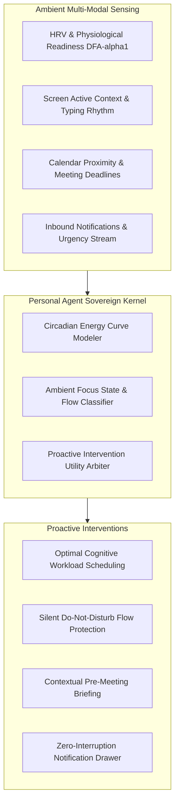

# personal-agent-skills


Sovereign **Personal Agent Master Orchestrator** for the OpenClaw / GenPark ecosystem. Built to liberate users from prompt fatigue, notification anxiety, and manual calendar juggling through zero-dependency mathematical modeling, circadian rhythm alignment, and ambient intent fusion.



## Distinctive Personal Agent Pillars

1. **Circadian Energy Awareness**: Matches heavy cognitive tasks to physiological peak focus windows ($E(h) = R \cdot \exp(-((h - \mu)/\sigma)^2)$) rather than naive calendar packing.
2. **Ambient Zero-Prompt Ingress**: Passively deduces user flow state from typing cadence, screen activity, and meeting proximity without demanding manual prompts.
3. **Utility-Gated Interruption Policy**: Mathematically computes net interruption utility ($U = 	ext{Importance} - c \cdot 	ext{Focus}$), preventing distraction unless urgent.
4. **Local-First & Sovereign**: 100% pure Python standard library. Zero third-party trackers, zero external telemetry leaks.

## Curated Personal Agent Skills in the Ecosystem

| Skill Repository | Core Personal Capability |
| :--- | :--- |
| **`genpark-personal-agent-dynamic-hrv-dfa-alpha1-intensity-fractal-skill`** | Real-time autonomic nervous system fatigue and DFA $\alpha_1$ aerobic-anaerobic threshold detection. |
| **`genpark-screen-zero-ambient-intent-scorer-skill`** | Zero-click glance surface intent recognition on lockscreens and ambient displays. |
| **`genpark-screen-context`** | Native desktop/mobile screen context OCR, UI element bounding, and active window state. |
| **`openclaw-genpark-memory-vault`** | Episodic personal memory vault using ACT-R spreading activation decay. |
| **`openclaw-genpark-inbox-liquidator`** | Automated personal inbox triage via Eisenhower matrix and auto-drafting. |
| **`genpark-meeting-to-tickets`** | Converts spoken personal notes and meetings into structured Linear/Jira tasks. |
| **`genpark-student-space`** | Spaced-repetition lifelong learning optimizer powered by SuperMemo SM-2. |
| **`genpark-phone-agent`** | Personal inbound call screening, IVR navigation, and automated appointment setting. |
| **`openclaw-genpark-receipt-ledger`** | Personal tax deduction tracking, receipt ledgering, and multi-currency expense reconciliation. |
| **`genpark-a2a-dating`** | Sovereign Agent-to-Agent preference alignment using the Gale-Shapley stable matching algorithm. |

## Quickstart

```python
from client import PersonalAgentOrchestrator

orchestrator = PersonalAgentOrchestrator()
tasks = [{"id": "t1", "title": "System Architecture Deep-Dive", "cognitive_load": 0.95}]
res = orchestrator.schedule_circadian_focus_blocks(tasks, circadian_peak_hour=10.5, current_hrv_readiness=0.90)

print("Scheduled Slot:", res["schedule"][0]["scheduled_slot"])
print("Average Cognitive Fit:", res["average_cognitive_fit"])
```

## FastMCP Integration

```bash
python -m personal-agent-skills.mcp_server
```

## License
MIT
